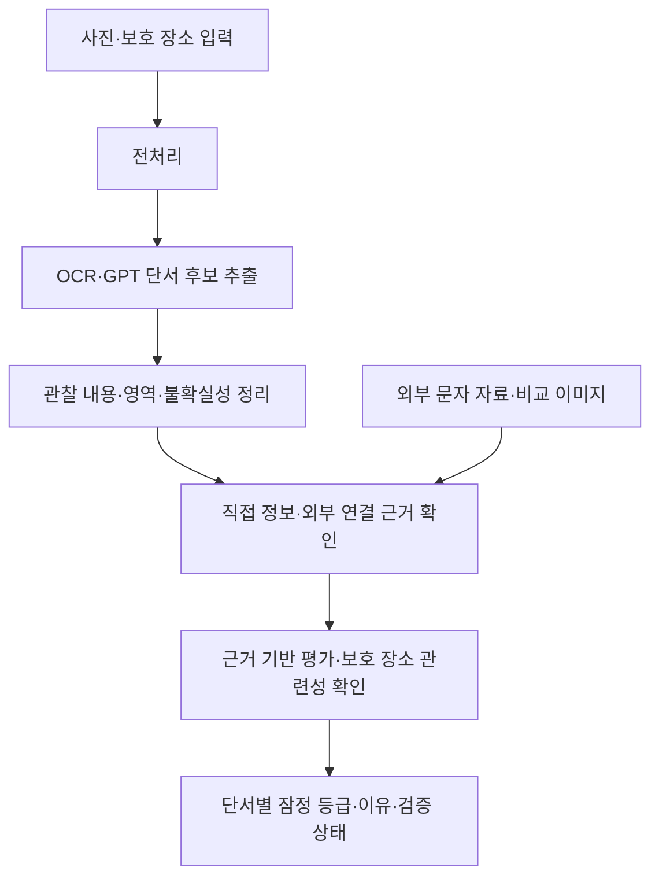
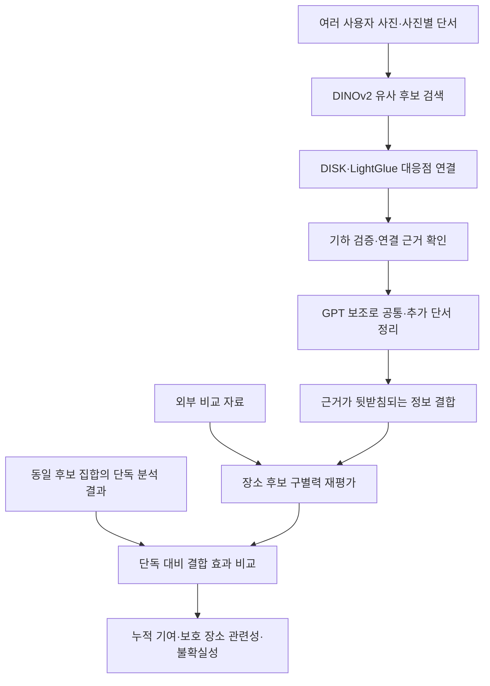

# 위치 단서 정의와 단일·누적 위험 분석 설계안

작성일: 2026-10-23

이 문서는 팀 논의를 위한 설계안이다. 단서 분류·위험 등급·모델 구성·결합 방식은 평가를 통해 조정한다. 현재 구현된 기능과 향후 제안을 구분하며, 이 문서가 실제 위치 추론이나 외부 이미지 수집 기능의 구현을 승인하는 것은 아니다. 해당 기능은 기존 제안서·PoC 범위와의 조율이 필요하다.

## 1. 위치 단서의 정의

**사진 자체만으로, 또는 다른 사진·외부 정보와 결합해 촬영 장소의 후보를 좁히거나 특정하는 데 활용할 수 있는 시각적 정보**를 위치 단서로 정의한다.

선명한 주소처럼 단일 사진에서 직접 읽히는 정보와, 건물 형태·공간 배치처럼 비교가 필요한 간접 정보가 모두 포함된다. 사진의 모든 객체를 위치 단서로 확정하지 않고, 먼저 후보를 추출한 뒤 근거를 확인한다.

다음 세 개념을 구분한다.

| 개념 | 의미 |
|---|---|
| 장소 식별 유용성 | 외부 정보와 결합했을 때 장소를 좁히거나 구별하는 데 얼마나 도움이 되는가 |
| 보호 장소 관련성 | 사용자가 보호 대상으로 등록한 집·학교·직장 등과 관련되는가 |
| 누적 기여 | 여러 사진을 함께 사용했을 때 개별 사진보다 식별 근거가 얼마나 증가하는가 |

모델의 탐지 확신도, 시각적 현저성, 대응점 개수는 위험도 자체가 아니다. 유명 관광지의 식별 유용성이 높아도 사용자의 보호 장소와는 무관할 수 있다.

## 2. 어떤 요소를 추출할 것인가

| 분류 | 추출 대상 예시 | 해석 시 주의점 |
|---|---|---|
| 문자·식별 표식 | 주소, 상호·지점명, 정류장명, 동 번호, 로고 | 광고나 포스터 속 주소가 실제 촬영 장소를 뜻하지 않을 수 있다. 체인점 로고만으로 지점을 특정할 수 없다. |
| 구조·외관 | 건물 형태, 출입구, 창 배열, 조형물, 실내 고정 구조 | 흔한 구조와 장소를 구별하는 특징을 구분한다. |
| 공간 배치·풍경 | 건물들의 상대 배치, 도로·시설 관계, 창밖 풍경 | 개별 물체보다 조합과 상대 위치가 단서가 될 수 있다. |
| 이동·변경 가능한 요소 | 가구, 화분, 포스터, 디지털 광고 내용 | 관찰 후보로 기록하되 고정된 장소 근거로 쉽게 확정하지 않는다. |

종류별로 위험도를 고정하지 않는다. 같은 간판도 판독되는 내용과 지점 구별 가능성에 따라 평가가 달라진다.

**반복은 객체 분류가 아니라 사진 사이의 관계**다. 일반적인 창틀은 실제 장소를 구별하는 능력은 약해도, 두 사진을 연결하는 데 도움이 될 수 있다. 단, 반복 무늬의 잘못된 대응 가능성을 확인해야 한다.

## 3. 이미지에서 각 요소를 어떻게 결정할 것인가

### 후보 추출과 구조화

1. 방향·크기를 정규화하고 메타데이터를 제거한 분석본을 만든다.
2. OCR로 문자 내용과 영역을 추출한다.
3. GPT 이미지 분석으로 구조·외관·배치 등 시각적 단서 후보와 맥락을 제안받는다.
4. 같은 요소의 OCR·시각 후보를 통합하고 관찰 내용과 불확실성을 기록한다.
5. 외부 비교 자료와 과거 사진을 이용해 연결 근거를 확인한다.

후보마다 다음 정보를 보관한다.

| 항목 | 기록 내용 |
|---|---|
| 종류·영역 | 후보 분류와 분석본 기준 정규화 좌표 |
| 관찰 내용 | 실제로 읽히는 글자나 보이는 구조·배치 |
| 관찰 가능성 | 판독·구별 가능한 정도, 가림과 해상도 한계 |
| 고정성·맥락 | 고정 구조인지, 이동 물체인지, 광고·반사 속 정보인지 |
| 연결 근거 | 다른 사진·외부 자료와의 대응 및 검증 상태 |
| 불확실성 | 확인하지 못했거나 모호한 부분 |

GPT에는 ‘위험한 독특한 건물’ 같은 결론보다 ‘곡선 외벽에 세로 창이 배열됨’처럼 관찰 가능한 특징을 먼저 기록하게 한다. 실제로 독특한지와 장소를 구별하는지는 비교를 통해 판단한다.

### GPT의 역할과 한계

GPT는 후보 추출·맥락 해석·근거 설명을 담당한다. GPT가 제안한 종류·영역·위험 등급은 정답이 아니다. 영역 좌표는 별도 확인이 필요하며 정밀한 이미지 편집 마스크로 그대로 사용하지 않는다.

GPT가 장소나 상호를 알고 있다고 답하는 것은 외부 자료 검증으로 취급하지 않는다. 실제 조회·비교 결과를 별도로 기록한다. 모델 원본과 사람 검토는 분리해 저장하고 원본을 덮어쓰지 않는다.

## 4. 위험도를 어떻게 평가할 것인가

위험도는 **외부 정보와 결합했을 때 해당 단서가 실제 촬영 장소를 좁히거나 특정하는 데 얼마나 유용한가**를 기준으로 판단한다.

| 평가 축 | 질문 |
|---|---|
| 정보의 명확성 | 문자나 구조를 충분히 읽고 구별할 수 있는가? |
| 장소 구별력 | 흔한 요소인가, 다른 장소 후보를 배제하는 데 도움이 되는가? |
| 연결 근거 | 검색 가능한 정보나 외부 비교 이미지와 구체적인 연결이 있는가? |
| 촬영 장소 관련성 | 실제 현장 정보인가, 광고·반사·이동 물체에 포함된 정보인가? |

초기에는 가중 합산 점수나 노출 확률 대신 잠정 등급과 이유를 사용한다.

| 등급 | 초기 판단 기준 |
|---|---|
| 낮음 | 정보는 관찰되지만 일반적이며 장소를 좁힐 근거가 약하다. |
| 중간 | 일부 후보를 구별할 가능성이 있으나 추가 단서가 필요하다. |
| 높음 | 장소를 크게 좁히거나 특정하는 데 강하게 기여할 근거가 있다. |
| 판단 불가 | 가림·판독 한계·비교 자료 부족으로 판단하기 어렵다. |

등급과 검증 상태를 분리한다. 예를 들어 모델이 지점명을 읽고 유용성을 높게 예상했어도 외부 자료와의 연결은 미검증일 수 있다. 비교 자료를 찾지 못한 사실만으로 낮음이나 안전을 판정하지 않는다.

예시 출력:

> 단서: 상호와 지점명 / 관찰: 두 문자열이 선명함 / 잠정 등급: 높음 / 검증 상태: 외부 연결 미검증 / 이유: 지점 구별 정보가 있으나 실제 현장 표식인지 확인 필요

`modelRisk`와 `humanRisk`, 각 판단 이유를 분리하고 미검토 `humanRisk`는 null로 둔다. 사진 전체 평가는 주요 단서·보호 장소 관련성·불확실성을 설명하는 방식부터 시작한다. 단서 점수의 단순 합산이나 반복 횟수에 따른 자동 가산은 보류한다.

## 5. 사용할 모델과 처리 방식

| 모델·기술 | 쉬운 설명과 역할 | 상태 |
|---|---|---|
| PaddleOCR / PP-OCRv5 한국어 인식 모델 | 글자가 있는 부분을 찾고 읽는 OCR 파이프라인의 도입 후보. 문자 검출과 한국어·영어 인식을 구성한다. | 미도입·성능 검증 필요 |
| GPT 이미지 분석 API | 시각적 단서 후보·맥락·불확실성을 설명한다. 누적 단계에서는 공통·추가 단서 정리를 보조한다. | 단서 추출 PoC에서 사용. 누적 의미 분석은 추가 설계 |
| DINOv2-small | 사진의 시각적 특징을 숫자 벡터로 바꾼다. 준비된 이미지 집합에서 비슷한 후보를 검색한다. | 구현됨 |
| DISK | 이미지에서 비교할 작은 특징점과 그 특징 표현을 추출한다. | 구현됨 |
| LightGlue | 두 이미지의 특징점 중 서로 대응할 만한 점을 연결한다. | 구현됨 |
| Homography + RANSAC | 연결들이 하나의 시점 변환으로 일관되게 설명되는지 검사하는 기하 계산. 학습 모델이 아니다. | 구현됨 |
| 근거 기반 평가 로직 | 단서의 명확성·구별력·연결 근거를 종합한다. 중복 단서와 누적 기여를 관리한다. | 설계 필요 |

기존 매칭 프로토타입은 기본적으로 로컬 CPU에서 실행한다. 초기 설계는 공개 사전학습 모델과 GPT API를 사용하며 별도 학습을 전제로 하지 않는다. 앱은 백엔드에 요청하고, 모델 실행과 GPT 호출은 백엔드 실행 환경에서 처리하는 구상이다.

GPT 모델명은 서버 환경변수 `OPENAI_MODEL`로 관리한다. 현재 `.env.example`의 예시는 `gpt-5.4-mini`이며 실제 사용할 모델은 추출 품질·비용·시간으로 검증한다. API 키는 서버 환경변수로만 사용하고 분석본만 전송한다.

DINOv2는 스트리트뷰 수집 도구가 아니다. 외부 이미지 확보·이용 조건 확인·문자 정보 조회는 별도 설계 대상이다. 외부 이미지 검색 정확도와 현재 모델의 장소 식별 적합성도 아직 검증되지 않았다.

## 6. 단일 사진 위험도 판단 파이프라인

입력은 사진, 사용자 지정 보호 장소와 필요한 외부 비교 자료다. 보호 장소가 없어도 단서의 식별 유용성은 분석할 수 있지만 보호 장소 관련성은 미확인으로 남긴다.

외부 근거 확인에서는 문자 정보 조회와 이미지 비교를 구분한다. 이미지 비교는 DINOv2 후보 검색 → DISK 특징점 추출 → LightGlue 연결 → 기하 검증 순서로 구성한다. 직접 정보가 명확한 경우 모든 이미지 매칭 단계를 반드시 거칠 필요는 없다.

최종 출력은 다음과 같다.

- 단서 영역·종류·관찰 내용과 불확실성
- 단서별 잠정 위험 등급·이유와 외부 검증 여부
- 사용자 보호 장소와의 관련성 및 주요 노출 근거

검증 목표는 **추출한 단서가 실제로 장소 구별에 기여하는지**다. 알려진 장소와 매칭됐다는 사실만으로 실제 외부인이 그 장소를 발견할 수 있다고 단정하지 않는다.

## 7. 누적 분석은 어디에 들어가는가

누적 분석은 단일 사진의 단서 분석 이후, 여러 사용자 사진 사이의 관계와 정보 결합을 다룬다. 외부 비교 이미지가 한 장인지 여러 장인지는 누적 분석 여부를 결정하지 않는다.

| 구분 | 의미 |
|---|---|
| 연결 단서 | 사진들을 함께 해석해도 된다는 시각적 근거 |
| 공통 단서 | 여러 사진에 반복적으로 보이는 정보 |
| 추가 단서 | 다른 사진에서 새롭게 확보되는 정보 |
| 결합 효과 | 정보를 함께 사용해 개별 분석보다 장소 구별 근거가 개선된 정도 |

예를 들어 A의 외관 일부가 B에서도 대응되고, B에는 지점명이 추가로 보인다면 두 정보의 연결을 검토할 수 있다. 이것만으로 A가 촬영된 위치를 확정하지는 않는다. 시각적 대응과 외부 장소 연결의 타당성을 각각 확인해야 한다.

같은 외벽이 반복되는 것과 새로운 식별 정보가 추가되는 것을 구분한다. 유사도·대응점 증가·사진 수 증가만으로 누적 위험이 증가했다고 판단하지 않는다.

## 8. 누적 위험 분석 파이프라인

연결이 불확실한 사진은 정보 결합을 보류한다. GPT는 의미 정리를 보조하며 동일 장소 여부와 누적 효과를 단독으로 확정하지 않는다. 같은 장소여도 겹치는 부분이 없어 매칭이 실패할 수 있으므로 연결 실패를 다른 장소라는 판정으로 사용하지 않는다.

최종 출력은 다음과 같다.

- 관련 사진과 연결 근거·불확실성
- 공통 단서와 추가 단서
- 사진별 분석 대비 결합으로 강화되거나 강화되지 않은 식별 근거
- 보호 장소와의 관련성

현재 모델 조합으로 구현된 것은 검색·부분 대응·기하 검증과 검토 도구다. 단서 의미 연결, 근거 결합 방식, 후보 재평가와 누적 등급은 추가 설계 대상이다. 결합 점수 공식과 임계값은 아직 확정하지 않았다.

## 9. 평가·검증 계획

### 판단 기준의 일관성

실제 사진에서 단서 후보 10~20개를 골라 팀원들이 독립적으로 종류·등급·이유를 기록한다. 의견이 갈린 사례로 기준을 수정한다. 사람 간 동의는 기준 일관성의 근거이며 실제 위치 식별력의 입증은 아니다.

### 단서 기여와 누적 효과

사용자가 등록한 정답 장소뿐 아니라 비슷하게 생긴 다른 장소를 같은 후보 집합에 포함한다.

| 비교 조건 | 확인할 내용 |
|---|---|
| 원본과 특정 단서를 가린 사진 | 해당 단서가 장소 구별에 기여하는가 |
| 무관한 영역을 비슷한 크기로 가린 사진 | 가림 자체의 영향과 단서 제거 효과를 구분할 수 있는가 |
| A만, B만, A+B | 결합이 각 사진의 단독 분석보다 개선되는가 |

측정값은 정답 장소 순위, 상위 K개 내 정답 포함률, 잘못된 장소 선택과 판단 보류다. 단독 대비 결합 결과는 같은 외부 후보 집합에서 비교하고, 가능하면 가장 잘된 단일 사진보다도 개선되는지 확인한다.

여러 장에서 정답 점수를 단순히 더하면 사진 수만으로 값이 커질 수 있으므로, 원시 점수 증가를 누적 효과로 해석하지 않는다. 기준·임계값을 정한 사진과 최종 평가 사진을 분리한다. 정답 장소 정보는 평가용으로 관리하고 검색·결합 단계에 정답이라는 사실을 주입하지 않는다.

결과는 준비한 후보 집합 안에서의 식별 가능성에 대한 근거다. 실제 외부인의 위치 발견 확률로 표현하지 않는다. 검증 결과로 단서 기준과 평가 로직을 조정하며, 0~100 점수나 확률값은 별도 타당성 검증 전까지 보류한다.

## 10. 구현 상태와 다음 결정 사항

| 항목 | 현재 상태 |
|---|---|
| GPT 기반 단서 후보 추출 | 기존 Feature Discovery PoC에서 구현. 사람 검토와 분리 |
| 이미지 전처리·DINOv2 검색·DISK/LightGlue·기하 검증 | 별도 매칭 프로토타입에서 구현 |
| 대응점 시각화·회차 관리·GPT 보조 검토 | 구현됨 |
| GPT 비교 영역 제안 | 별도 실험 구현. 자동 단서 확정 기능은 아님 |
| PaddleOCR 및 두 PoC의 통합 | 미구현 |
| 외부 자료 수집·조회·위치 식별 검증 | 추가 범위 합의와 설계 필요 |
| 의미 단위 단서 연결·근거 결합·위험도 평가 | 설계·검증 필요 |

다음으로 단서 분류의 실제 사례, 모델 입력·출력 스키마, 외부 비교 범위, 사진 연결 보류 기준, 단서 결합 방식과 성공 기준을 합의한다. 위치 추론 결과의 사용자 제공 여부는 내부 평가와 별도로 결정한다.

## 참고

- [PaddleOCR 문자 인식 모델 설명](https://github.com/PaddlePaddle/PaddleOCR/blob/main/docs/version3.x/module_usage/text_recognition.en.md)
- [DINOv2-small 모델 카드](https://huggingface.co/facebook/dinov2-small)
- [LightGlue 공식 코드와 DISK 연동](https://github.com/cvg/LightGlue)
- [현재 이미지 매칭 프로토타입](../prototype/README.md)
- [기존 파이프라인 방법론](../pipeline.md)
